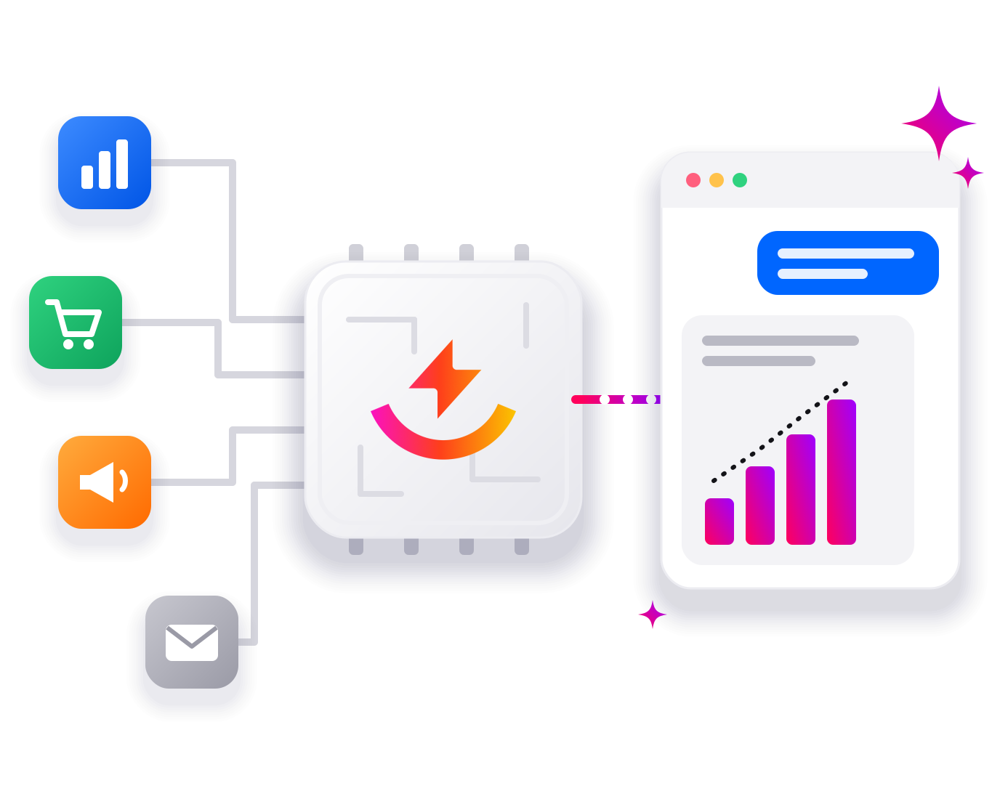

<p align="center">
  
</p>

# Power My Analytics MCP Server

Connect Claude, ChatGPT and any MCP-compatible AI assistant to your marketing data. The Power My Analytics MCP server gives your assistant secure access to the data in your [Power My Analytics](https://www.powermyanalytics.com/) hub: 85+ advertising, analytics, social, ecommerce, email and CRM sources, including Google Ads, Meta, GA4, Search Console, Shopify and HubSpot, warehoused with full history.

Ask questions across every platform at once, compare periods and channels, explain what changed, spot anomalies and forecast pacing, all from your real numbers.

> **This repository contains documentation and the registry listing only.** The MCP server is a hosted service operated by Power My Analytics. There is nothing to install or run.

| | |
|---|---|
| **Server URL** | `https://mcp.powermyanalytics.com/mcp` |
| **Transport** | Streamable HTTP |
| **Authentication** | OAuth 2.1 (sign in with your Power My Analytics account) |
| **Registry name** | `com.powermyanalytics/mcp` ([official MCP Registry](https://registry.modelcontextprotocol.io/v0/servers?search=com.powermyanalytics)) |
| **Website** | https://www.powermyanalytics.com/integrations/mcp/ |

## Requirements

1. A Power My Analytics account. [Start a 14-day free trial](https://hub.powermyanalytics.com/trial) (no credit card required).
2. Your marketing accounts connected inside Power My Analytics. History backfills automatically.
3. **MCP access turned on** in your Power My Analytics settings. It's included on every plan.

## Connect your AI assistant

When you connect, your assistant opens a Power My Analytics sign-in page. Sign in once and the connection is ready.

### Claude (web and desktop)

Add a custom connector in Claude's connector settings with this URL:

```
https://mcp.powermyanalytics.com/mcp
```

Step-by-step guide: [Connect to the PMA MCP server from Claude Desktop](https://support.powermyanalytics.com/portal/en/kb/articles/connect-to-the-pma-mcp-server-from-claude-desktop)

### Claude Code

```bash
claude mcp add --transport http power-my-analytics https://mcp.powermyanalytics.com/mcp
```

Step-by-step guide: [Connect to the PMA MCP server from Claude Code](https://support.powermyanalytics.com/portal/en/kb/articles/connect-to-the-pma-mcp-server-from-claude-code)

### ChatGPT

Add Power My Analytics as a connector in ChatGPT using the server URL above. See [Power My Analytics for ChatGPT](https://www.powermyanalytics.com/integrations/chatgpt/) for details.

### Cursor

Add to `~/.cursor/mcp.json`:

```json
{
  "mcpServers": {
    "power-my-analytics": {
      "url": "https://mcp.powermyanalytics.com/mcp"
    }
  }
}
```

### VS Code

Add to `.vscode/mcp.json`:

```json
{
  "servers": {
    "power-my-analytics": {
      "type": "http",
      "url": "https://mcp.powermyanalytics.com/mcp"
    }
  }
}
```

### Other MCP clients

Any client that supports remote MCP servers over Streamable HTTP with OAuth can connect using the server URL. OAuth metadata:

- Protected resource: `https://mcp.powermyanalytics.com/.well-known/oauth-protected-resource`
- Authorization server: `https://mcp.powermyanalytics.com/.well-known/oauth-authorization-server`

## Example questions

- "Which campaigns across Google Ads and Meta had the best ROAS last month?"
- "Why did conversions drop last week, and which campaigns drove it?"
- "Compare this quarter's spend to last quarter by platform."
- "Are we on pace to hit this month's lead target?"
- "Flag any days where cost per click spiked unusually."

## Tools

| Tool | What it does |
|---|---|
| `pma_list_data_sources` | Lists the platforms and accounts connected to your hub |
| `pma_list_usages` | Lists the individual data sources (sub-accounts) within each connection |
| `pma_list_accounts_with_token_status` | Lists connected accounts and the health of their sign-in tokens |
| `pma_get_token_health_summary` | Summarizes connection health across all accounts |
| `pma_describe_platform` | Shows the report types and fields available for a platform |
| `pma_inspect_org_data` | Shows which platforms and report types have data, and for which dates |
| `pma_query_performance` | Returns raw rows from a platform report |
| `pma_query_custom` | Groups, ranks and analyzes a platform's data within a date range |
| `pma_get_account_summary` | Returns headline totals such as spend, conversions and revenue |
| `pma_get_date_range_comparison` | Compares a metric between two periods |
| `pma_get_trend` | Shows how a metric moved over days, weeks or months |
| `pma_compare_sources` | Ranks one metric side by side across platforms |
| `pma_analyze_drivers` | Explains which campaigns, countries, devices and so on drove a change |
| `pma_detect_anomalies` | Finds days where a metric deviated from normal |
| `pma_detect_significant_anomalies` | Finds statistically unusual days after removing the weekly pattern |
| `pma_detect_changepoints` | Finds sustained level shifts in a metric's history |
| `pma_detect_seasonality` | Separates a metric into trend, seasonal pattern and noise |
| `pma_forecast` | Projects the coming days with an uncertainty range and checks pacing |
| `pma_analyze_cohorts` | Builds monthly retention cohorts |
| `pma_analyze_correlation` | Tests whether metrics move together day to day |
| `pma_list_available_analyses` | Lists which statistical analyses are available for your data |
| `pma_list_datasets` | Lists your Data Builder datasets (multi-source reporting workspaces) |
| `pma_get_dataset` | Shows a dataset and its data tables |
| `pma_get_dataset_data` | Returns the blended rows from a dataset |
| `pma_get_data_table_data` | Returns rows from one data table in a dataset |
| `pma_list_dataset_templates` | Lists pre-built dataset recipes for common marketing stacks |
| `pma_create_dataset` | Creates a new Data Builder dataset |
| `pma_add_data_table` | Adds a data table to an existing dataset |
| `pma_list_activity` | Lists recent activity in your account |

## Security and privacy

- Your assistant connects through OAuth with your Power My Analytics account. No API keys are copied or shared.
- Your assistant can access only the accounts in your Power My Analytics hub, and you can disconnect it at any time.
- Power My Analytics is SOC 2 Type II and ISO 27001 certified, and data is encrypted in transit and at rest.
- Power My Analytics does not use your data to train AI models. See the [privacy policy](https://www.powermyanalytics.com/privacy/#ai-features) and [security overview](https://www.powermyanalytics.com/security/).

To report a security issue, see [SECURITY.md](SECURITY.md).

## Links

- [Power My Analytics MCP Server](https://www.powermyanalytics.com/integrations/mcp/)
- [MCP server documentation](https://support.powermyanalytics.com/portal/en/kb/articles/introducing-the-power-my-analytics-mcp-server)
- [All 85+ connectors](https://www.powermyanalytics.com/connectors/)
- [Pricing](https://www.powermyanalytics.com/pricing/)
- [Support center](https://support.powermyanalytics.com/portal/en/home)

## About this repository

This repository is the public listing for the Power My Analytics MCP server. `server.json` is the source of truth for the [official MCP Registry](https://registry.modelcontextprotocol.io/) entry `com.powermyanalytics/mcp`. Pushing a version tag (for example `v1.0.2`) publishes the matching `server.json` to the registry automatically. See [CHANGELOG.md](CHANGELOG.md) for release history.
